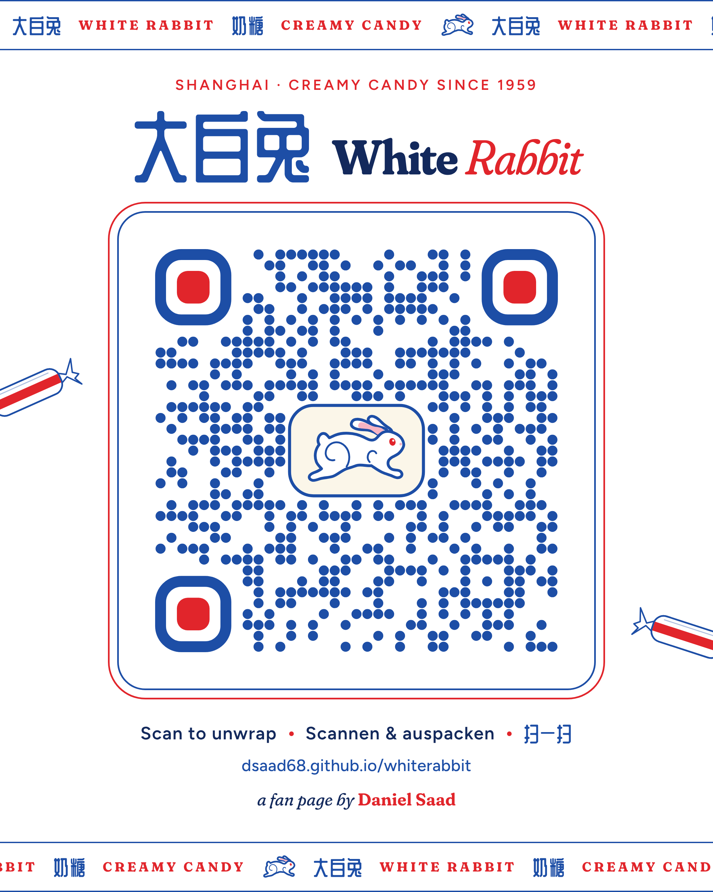

# White Rabbit

A fan page about White Rabbit candy (大白兔奶糖) in English, German and Chinese, for phones and wide screens.

Live at **https://dsaad68.github.io/whiterabbit/**

By **Daniel Saad**.

  

Scan it to open the page. The card and a plain version (`qr/whiterabbit-qr.png`, `qr/whiterabbit-qr.svg` for print) are made by `python3 qr/make_qr.py`, then rendered with `node qr/render.js`.

The page is a single self-contained `index.html` (fonts come from Google Fonts). GitHub Pages serves it straight from the root of `main`; `.nojekyll` turns off Jekyll processing.

## Editing

- **Words** live in `content.py`. After editing, run
  `python3 build_content.py content.py index.html`
  which replaces the block between `CONTENT:BEGIN` and `CONTENT:END`.
- **The rabbit** lives in `rabbit.json`: three poses (`leap` for the logo, prints and icons; `gather` and `stretch`, which the History rabbit morphs between) with one shared path structure. After editing, run
  `python3 build_rabbit.py rabbit.json index.html`
  which rewrites the `<symbol id="rabbit-sym">` and the `RABBIT:BEGIN` … `RABBIT:END` block. Line weights per size are the `--rw` / `--rwl` CSS variables.

Commit the rebuilt `index.html`; the site updates when it lands on `main`.

Moved here from `dsaad68/china-trip` (`white-rabbit/`), history included.
